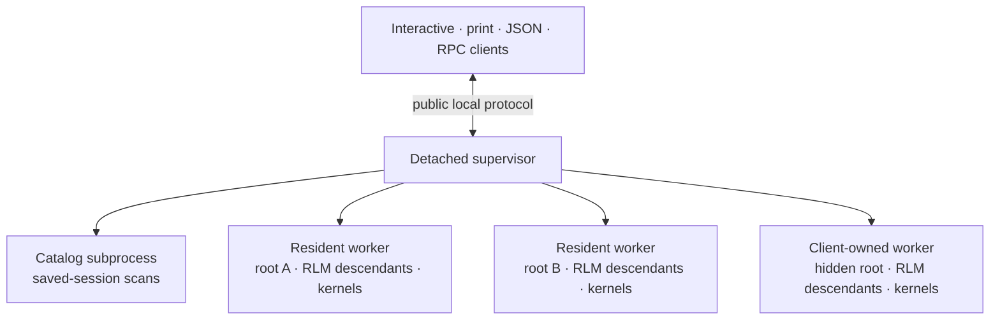

# Daemon Architecture

Prime Agent isolates each active root session tree in its own process. The daemon is internal infrastructure: interactive, print, JSON, RPC, piped-stdin, and `--no-session` describe client behavior and retain their public I/O contracts.

## Repository daemons

Inside a Git repository, session commands use that repository's daemon by default.
Subfolders and linked worktrees share the main checkout's daemon. Submodules use their own daemon.
Outside a repository, the default remains the shared daemon.

The repository socket is `<defaultDaemonSocketDir()>/<name>-<checksum>.sock`.
The name comes from the repository folder. The checksum is POSIX `cksum` of its absolute path.
Sessions are saved in `<root>/.prime/agent/sessions`, with artifacts in the sibling `session-artifacts` folder.
For a root named `.prime`, these folders are `<root>/agent/sessions` and `<root>/agent/session-artifacts`.
Existing saved sessions elsewhere are not moved.

The CLI creates both folders and adds root-anchored entries to Git's local exclude file when needed.
It warns and continues if a folder cannot be ignored. Ignore rules do not affect files already tracked by Git.

`--daemon-socket <path>` selects another daemon and disables repository routing.
`--session-dir <path>` also disables repository routing, keeping the shared daemon unless an explicit socket is given.
`--no-session` keeps the existing non-daemon behavior.
With no repository daemon listening, `list` and `sessions` report no active agents without starting a daemon.
`list --all` still requires a running daemon.

## Process Topology



The supervisor owns public sockets, client attachments, routing, global agent-message delivery, worker health, command journals, and coordinated updates. It does not execute providers, tools, compaction, bash, kernels, schedules, or transcript scans.

The catalog subprocess owns saved-session scans and inactive-session file operations. A catalog failure can fail a catalog request without interrupting active workers.

Each worker owns one root `AgentSessionRuntime`, its root `AgentSession`, scheduler, kernels, and every RLM descendant below that root. New, switch, fork, and import operations replace the root runtime inside the worker while preserving the public active-session ID.

## Resident Workers

Normal interactive sessions use resident workers:

- The supervisor starts one detached process group per active root tree.
- Closing the TUI detaches the client; it does not stop the worker.
- Worker descriptors, authentication tokens, active-session IDs, session paths, and recovery journals are written with owner-only permissions under the agent directory.
- Workers monitor the public supervisor socket. If it disappears, one worker acquires an atomic launch lease and starts a replacement supervisor.
- A replacement supervisor adopts live workers and their active-session IDs.
- A worker crash affects one root tree. Recovery retries after 250 ms, 1 second, and 5 seconds; three failures mark that root failed.
- `prime-agent shutdown` stops the supervisor and all workers; `--force` also terminates unresponsive worker process groups and tracked children.

There is no fixed session, worker, client, or workload cap in this layer.

## Client-Owned Workers

Headless and ephemeral clients use the same worker runtime as interactive clients but give the worker a client-owned lifecycle:

- print, piped stdin, and JSON mode remain one-shot;
- RPC keeps LF-delimited JSONL framing and accepts prompts until EOF;
- interactive `--no-session` uses an in-memory session;
- normal completion explicitly removes the worker without archiving it;
- unexpected client loss starts a bounded cleanup grace period;
- reconnect with the same stable client identity cancels cleanup; and
- default lists, global schedules, and peer routing omit client-owned workers unless the owner explicitly addresses them.

The full launch environment remains in supervisor memory and is not written to the worker descriptor. Direct SDK calls to print and RPC modes remain in-process so embedders can pass non-serializable extension factories.

## Session Ownership and Leases

Every persisted session is protected by a process-safe lease keyed by canonical JSONL path.

- A worker acquires a target lease before opening a session.
- Runtime replacement acquires the new lease before releasing the old one.
- Concurrent opens return `session_already_active` with the owning active-session ID.
- Concurrent creates for the same path converge on one worker launch.

This prevents daemon workers and one-shot clients from writing the same transcript concurrently.
Native agent-message wakes also refuse a saved copy when a lease snapshot finds the same session ID live at another canonical path.

## Mesh Agent Messaging

Set `"agentMessageTransport": "cotal"` in global settings for durable agent messages
across daemons on this computer. Project settings cannot enable it. Activation needs
operator approval; after approval, run `prime-agent restart` after changing it.
The default, `"native"`, keeps existing family messaging unchanged.

On macOS, `prime-agent mesh install` creates `<agent dir>/mesh`, starts a launchd agent,
waits for the broker, and creates the private signer. It requires Cotal CLI 0.79.0 on
`PATH`. Install and doctor refuse any other version, malformed output or version-read
failure before installation changes or doctor diagnostics. The CLI header decides
compatibility, not adapter versions. Keep the resolved executable at 0.79.0; an external
upgrade after installation is not prevented.
The service runs `cotal up --space prime --server <URL> --no-manager` in the mesh home,
with `COTAL_HOME=<mesh home>/home`. Options are `--mesh-home`, `--server nats://127.0.0.1:<port>`
and `--label ai.prime.mesh.<name>`. `--mesh-home` is test-only.
Cotal renews its 24-hour daemon credentials only from its manager, which `--no-manager`
omits. Install therefore adds a second launchd agent, `<label>.renew`, that runs
`cotal doctor auth --fix` in the mesh home at load and every 10 minutes. Cotal's repair
re-signs only credentials past their renewal point, at 75% of their lifetime. It logs to
`<mesh home>/renewal.log`, about 125 KB a day.
The two $SYS credentials, `membership-observer.creds` and `connection-evictor.creds`,
have a 30-day lifetime. The renewal agent cannot re-sign them. Install adds a third
agent, `<label>.rotate`, that runs `prime-agent mesh rotate --if-due` daily at 04:00
local time. It rotates when either credential reaches 75% of its lifetime, about
every three weeks. Its command output goes to `<mesh home>/rotation.log`; broker
boot output stays in `service.log`. The job uses the managed native installation's
upgrade-stable launcher when available. Otherwise, install requires the absolute
`prime-agent` entry on `PATH` to resolve to the running CLI. It keeps that entry,
not its resolved symlink target, so an upgrade can replace the target. A shadowing
installation on `PATH` is refused before mesh files are written.

Install refuses an occupied service, renewal or rotation label, or broker port.
Labels ending in `.renew` or `.rotate` are reserved. If startup, signer creation or
loading either scheduled agent fails, install attempts to remove all three agents
and plists but keeps the home. Scheduled failures appear in `rotation.log`. Status
and doctor report the rotation job's last exit code and fail once either $SYS
credential is more than 26 hours past its 75% renewal point, even if the job remains
scheduled. The error names `rotation.log` and `rotation.lock` for investigation.

- `prime-agent mesh start` and `stop` start or stop the installed service.
- `prime-agent mesh status` first checks every RLM ledger locally, even without the
  mesh home, broker or Cotal CLI. If the mesh home or its `.cotal` directory is missing,
  it stops after that check. Full status output includes the CLI version or its read
  failure, service state, renewal-agent and rotation-agent states, the rotation job's
  last exit code, $SYS last-rotation and expiry times, store bytes, service-log and
  renewal-log bytes, enrolled-session count, and each
  session's stored, unacknowledged message count. A missing renewal or rotation
  agent fails status; reinstall the mesh to add it. A leftover temporary rotation
  plist also fails status. An unreadable $SYS credential is reported by filename;
  status finishes broker, store and session diagnostics before failing.
- `prime-agent mesh doctor` checks the exact CLI version first, then ledger and status
  health, then Cotal auth. A failed version check still stops before ledger diagnosis;
  use `mesh status` for that offline check. An unhealthy check sets exit code 1.
- `prime-agent mesh rotate` rotates the $SYS credentials now. With `--if-due`, it
  changes nothing when neither credential is due and prints the next due time.
  Missing or malformed credential lifetimes fail before the service stops.
- `prime-agent mesh uninstall` removes all three agents and plists, including any
  temporary rotation plist, not the mesh home, signer, enrollment records or stored
  messages. It also works with older installs that lack the scheduled agents.
- Install, uninstall, start, stop and rotate refuse platforms other than macOS
  without changes.

Rotation normally causes an outage of up to about a minute. The configured waits
and tool timeouts allow up to 272 seconds (about 4.5 minutes) including failure
and recovery. This excludes filesystem delays and process-scheduling overhead.
Sessions reconnect afterward. If the service was stopped with `mesh stop`, rotation
still renews the credentials, then sends SIGTERM to the restored service to keep
it stopped, including after a failed rotation.
It stops the renewal and service jobs, then waits for the broker port and recorded
Cotal processes to stop. A temporary foreground launchd job boots the same service
with `--rotate-sys` and no `KeepAlive`. After both $SYS issue times advance and their
30-day lifetimes are verified, rotation stops that job, waits for its processes to
exit, and restores the installed service and renewal jobs. The installed service
plist never changes. Cotal 0.79.0 on macOS cannot reliably stop its delivery daemon
through `cotal down`; rotation uses launchd and waits for that daemon to exit itself.
Each stop wait has a 30-second deadline; its final port probe can take one second
more. No failed step is hidden; recovery still attempts to restore both installed
jobs, even when a job lookup fails or is killed.
SIGINT, SIGTERM and SIGHUP are deferred while jobs are stopped; recovery finishes
before rotation exits nonzero naming the signal. The 272-second bound includes
three bootouts (5-second calls plus 30-second removal waits), two process/port
stop waits (up to 31 seconds each, including the final 1-second port probe), two
30-second readiness waits, and nine other 5-second calls (version, preflight
lookups, temporary bootstrap, restore lookups and bootstraps, and a final stop).
The scheduled agent sets `ExitTimeOut` to 330 seconds, leaving 58 seconds of margin.

Rotation holds `<mesh home>/rotation.lock` exclusively and records its owner PID.
A concurrent rotation refuses to run while that PID is live. A later rotation takes
over a dead owner's lock and reports it. Unreadable owner content refuses rotation;
confirm no rotation process is running before removing that lock. If
`rotation-boot.plist` remains, status reports that recovery is needed. After
confirming no rotation is running, uninstall and reinstall the mesh. If the jobs
are unloaded but no temporary plist remains, restore the service first with
`launchctl bootstrap gui/$UID ~/Library/LaunchAgents/<label>.plist`, then restore
the renewal job with `launchctl bootstrap gui/$UID ~/Library/LaunchAgents/<label>.renew.plist`.

**Warning:** Rotation makes earlier full Cotal backups unrestorable against the new
trust chain. Take a fresh full backup after rotation. The data account, agent
credentials and JetStream store are unchanged.

`cotal status --components` also probes other entries in the mesh home's private Cotal
registry, which install creates with only Prime's broker.

A session with a session file enrolls on create or open. The supervisor takes its claim,
reuses or creates a private enrollment record, provisions the inbox, writes a directory
entry, and starts an endpoint. The identity stays the same across restarts. Children
enroll only after they have a session file. Fileless sessions cannot send or receive.
All daemons must use the same agent directory.

Any process running as the same OS user that can read the mesh files can act as the
mesh signer. The mesh is not a security boundary between those processes.

A claim permits one supervisor to pull a session's inbox. A live claim held elsewhere
prevents a second endpoint. The holder delivers to idle or saved sessions and wakes a
worker when needed. Opening elsewhere does not transfer a live claim. A session opened
in a daemon that does not hold its claim cannot send agent messages, including to its
family. Closing a worker or its session does not release the session's mesh claim.
Open the session in the daemon that holds its claim.
Stopping that daemon releases its claims. Workers from
before mesh support must be restarted; restarting only the supervisor can leave them
running. Mesh sends and handoffs refuse old workers with a restart message. Sends from daemon
clients that are not sessions (`prime-agent send` and RPC `send_message`) are refused in
Cotal mode and have no mesh path.

Switching to the current enrolled file also takes the replacement barrier: the
endpoint closes before the open, and held messages return without an early acknowledgement.
A foreign claim refuses before file or runtime changes with `claimed by another daemon`.
The revision-35 begin fields `sessionFile` and `overwrite` remain accepted but unused.
Same-ID import and switch refuse when another holder is live, the supervisor offers
no replacement barrier (restart the daemon), or the worker predates the barrier
(restart that session). After a post-copy failure, stop the failed session and reopen
its file from disk before mesh delivery resumes. The barrier clears queued mesh
messages. They return after the broker's acknowledgement wait, even when the
replacement is cancelled.

`<mesh home>/directory/` carries IDs, names, principals and home sockets, never secrets.
An exact ID wins; otherwise a case-insensitive name must match exactly one entry.
Unknown targets, ambiguous names and another space have distinct errors. Renames update
the entry under a per-session lock. Deletion removes the entry before the enrollment
record under that lock, so stale publication cannot restore the entry.

Deleting a session closes its endpoint before removing its lifecycle's inbox while
holding its claim. If another live supervisor holds the claim, deletion leaves the inbox
and logs the session ID.

The holder removes the inbox when it next finds the entry gone, before a handoff or at an
endpoint start. An idle holder keeps the inbox until one of those checks runs. A partial
removal is logged and not retried; consumers left still count toward the limit.
A failed endpoint close keeps the claim and prevents a second endpoint.
Whole-mesh shutdown releases claims before exit. Queued deliveries and late persistence
frames settle nothing after close.

When the mesh is on, deleting a session discards stored, unacknowledged messages, and
restoring it from Trash does not restore them. Deleting while the transport is native
leaves that session's directory entry, enrollment record and inbox unchanged. A stale
entry can still accept stored messages, but startup skips a missing file and those
messages wait. If an active endpoint finds its file missing, each handoff refuses
before waking a worker or recreating the file, leaves the message unacknowledged,
and logs the session and missing-file reason. No automatic repair is added.

Deliberately deleting an RLM child retains its transcript but removes its mesh entry,
record and, when its claim is available, lifecycle inbox. Only a committed ledger
delete for that exact canonical child path authorizes this exception to file absence.
An ordinary roster removal, a session swap or an unbound queued child is not proof.
The retained transcript cannot re-enroll even on explicit reopen, so that session
cannot send or receive agent messages in Cotal mode. There is no clear-on-open rule.

Saved-session deletion in either transport acquires the canonical session-file lease
before any removal or child tombstone. It also reserves saved child transcripts and
other session files under that session's artifact directory. A live lease anywhere in
that set refuses the whole delete and names the held path, without changing files,
artifacts, child tombstones or mesh state. Close that session there first, then retry.
An unreadable or corrupt lease owner also refuses deletion. File symlinks share their
target's lease; symlinked directories are not traversed. Same-ID copies at different
canonical paths stay independent. Other artifact files without a lease or a first-line
session header are skipped, without creating lease records.
The artifact scan is a point-in-time snapshot. Files created after the scan are not reserved.
Deletes check leases only in the daemon's agent directory, so leases under a different
agent directory are not seen.

After a successful forwarded delete, the worker releases its lease before the
supervisor's unchanged mesh cleanup. That cleanup still checks the exact file's absence.

Direct SDK runtimes participate only when session leases are enabled. Other writers can
still recreate a deleted transcript. With the mesh on, it can re-enroll after restart
with a new identity and lifecycle, but the old inbox's messages are lost.
The directory lock alone does not prevent that recreation.

There is no per-daemon endpoint cap. NATS's default is 1000 consumers per stream, so the
space supports about 1000 enrolled inboxes. Each uses one consumer in `DM_prime` and one
in `DLV_prime`. Presence and channel watches are off. Status prints
`DM_prime: <count> consumers / 1000` and the equivalent `DLV_prime` line. Counts can differ
after partial removal. Orphan consumers count even without an enrollment record.
These lines count durable consumer directories on disk. Cotal's pending-count inspection
can leave temporary memory-only DM consumers. They also use the limit but are not in
these disk counts. The client sets a five-minute inactivity threshold and attempts
immediate cleanup.
The broker store has no retention limit. `service.log` and `renewal.log` are not rotated.
Monitor the reported sizes; a full disk can make sends fail. Status queries pending counts
once per enrollment and gets slower as the number of sessions grows.

Deletion lookups run under the directory lock. Cache hits skip replay but still stat,
open and close every ledger. An append invalidates the cache; replaying all ledgers
lengthens the hold. Under load the lock can give up after about one second, leaving
entry, record and inbox state behind. The failure is logged and is not retried.

Any unreadable, malformed or over-bound committed `*.jsonl` ledger under
`<agent dir>/rlm-ledger/` blocks new mesh enrollment, directory publication and deletion
reconciliation for every session in that agent directory, including top-level sessions.
Existing endpoints need not stop, but restarted sessions can be unavailable. The log
names the file and cause. Failed reconciliation authorizes no removal of existing mesh state.

`mesh status` and `mesh doctor` report every independently failing ledger, with its
path, cause and parse line or read limit. `CHECKED` is a point-in-time read, not a
promise that a later append stays healthy. The check uses the same committed-line
parser and bounds as enrollment. An unterminated final line remains uncommitted and
is ignored unless the file already exceeds the byte limit. Diagnosis changes no
ledger, directory entry, enrollment record or inbox.

**Warning:** Moving a ledger out of that directory removes its topology and deletion
proof. Its deliberately deleted children can then re-enroll. Do not move it without
accepting that loss of protection.

To recover:

1. Stop all writers for that agent directory, including workers that can outlive a
   supervisor restart.
2. Back up each exact reported file before changing it. Do not hand-edit committed records.
3. Choose the recovery that matches the failure:
   - For an uncommitted, unterminated tail, remove only that tail.
   - For a bad interior or other committed record, or a record or byte limit failure,
     an older backup can omit later deletion records. Deliberately deleted children
     can then re-enroll. Check that loss of protection before restoring a usable
     trusted backup. If no usable backup exists, move the file outside the ledger
     directory only after accepting the loss described in the warning above.
   - For a read or access failure, correct file access as needed.
4. Restart the writers and retry the session open.

Prime does not repair, truncate, move or restore ledgers during diagnosis.

A successful send returns `deliveryStatus: "stored"`, a stream sequence and a Cotal ID.
This means the broker stored the message, not that the target wrote it. A delivery is
acknowledged only after its own entry is written, or after an explicit cleared/closed drop.
Crashes and other drops leave it unacknowledged for redelivery. A delivery above the first
marks its text as possibly repeated. Already-held IDs are not added again.

The broker can lose recently stored messages on a power loss or OS crash before
it syncs them to disk.

- `Message was not stored: ...` names a failure before publish: mesh unavailable,
  missing enrollment or directory, unknown/ambiguous target, or a reconnect deadline.
  Reconnect waits share the send's total 30-second budget. There is no native fallback.
- `Message storage outcome is unknown: ...; a resend can show the message twice`
  means publish failed or its acknowledgement did not arrive within that budget.
  The broker might have stored it. Prime does not retry; check the target before resending.
- Enrollment, wake and inbox-removal errors log the session ID and a redacted reason.
  Missing or invalid signers refuse enrollment and sends without printing their contents.

To roll back after activation, set `"agentMessageTransport": "native"` and run
`prime-agent restart`. Stored, undelivered messages stay on the broker until mesh mode
is enabled again.
They are neither lost nor sent natively. `prime-agent mesh status` reports how many remain.

## Scheduling

Each worker runs one scheduler for its root and descendants. Jobs are persisted per session in `session-artifacts/<session-id>/scheduled-jobs.json`; workers do not share a global cron file.

Due ticks are claimed and advanced before prompt delivery. A crash therefore does not replay an uncertain prompt. Different target sessions dispatch independently, and a still-active claim coalesces later missed ticks instead of building an unbounded backlog.

Resident workers keep scheduling across supervisor replacement. Worker recovery marks uncertain claims interrupted, keeps the advanced schedule, and resumes future ticks only. The supervisor routes schedule commands and merges worker summaries for global listing.

## Automatic Runtime Reload

Set `"autoReload": "idle"` in global `settings.json` to reload runtime files automatically.
The default is `"off"`. Project settings cannot enable it. This applies to every
session in a daemon worker, including its child agents, but not in-process SDK sessions.

Each worker checks every 15 seconds. It compares the loader's input snapshot with
current file paths, sizes and modification times. A change must stay the same across
two enabled checks before an idle session enters the queue. Reloads run one at a time
per worker. Busy sessions wait until their own work and running children end.
Queued actions, next-turn messages and accepted prompts also defer reload.
The session checks again after holding input, so work or a runtime replacement that
arrives while it waits prevents the reload.

Inputs include default and configured resource roots, local package directories and
manifests, context files, `SYSTEM.md`, `APPEND_SYSTEM.md`, explicit prompt files, and
resources added by extensions. The reload-relevant settings are `packages`,
`extensions`, `skills`, `prompts`, `themes`, `enableSkillCommands`, `enableBuiltinSkills`,
`bundledSkills`, `codemode`, `codemodeOpenAPI`, `codemodeExcludeTools`, `mcpServers`,
`mcpCatalogSources`, `shellPath`, `shellCommandPrefix` and `decisionApi`.
Other settings do not trigger reload. Neither do `auth.json`, `models.json`,
`keybindings.json`, transitive extension imports or npm package internals.
Dot entries, `node_modules`, `.git`, `__pycache__` and `.venv` below watched roots are excluded.
Unreadable inputs, inventories above 20,000 entries or trees deeper than 12 disable
automatic reload for that session. Edits that preserve size and modification time
can be missed. Two-check settling reduces, but cannot prevent, loading a partial update.

**Every automatic reload restarts the Python kernel.** Values that cannot be saved,
values above 16 MiB each, or values above the 256 MiB total limit can be lost.
A visible transcript entry names the changed areas and kernel restart. Extensions
receive `session_start` with `reason: "reload"` and `trigger: "auto"`. Restore
notices name lost values. A failed reload can leave a partly rebuilt runtime;
it adds a failure entry and is not retried until its inputs change.

Turning the setting off takes effect at the next check. It drops reloads that have
not started and clears pending comparisons. Turning it back on needs two checks.
Graceful worker shutdown waits without a time limit for a started reload, with a
warning every 30 seconds. Update restart keeps its existing preparation limit.
If that limit ends during a reload, the update fails with an error naming that
reload, rolls back, and can be retried. The reload keeps running. A hung extension
can therefore block graceful worker shutdown and make updates fail until it ends.
The supervisor can finish shutdown while marking the worker for recovery.
Use `prime-agent restart --force` or send SIGKILL to the worker if a reload cannot finish.
Repeated edits can cause repeated reloads; turn `autoReload` off to stop that churn.

## Public Daemon Protocol v4

The public local socket is JSONL-framed. The current protocol provides:

- versioned command envelopes with stable client and command IDs;
- capability negotiation and per-command compatibility metadata;
- generation-aware event cursors `{ generation, sequence }`;
- reconnect with a stable identity and resume cursor;
- attach acknowledgment plus coherent snapshots;
- begin/chunk/end snapshot streaming with a 512 KiB target chunk size;
- file-backed transcript caches above 4 MiB;
- resident and client-owned worker lifecycle commands;
- daemon-side headless completion, session-header, bash, and retry operations; and
- structured errors for recoverable cases such as an already-active session or uncertain mutation result.

Protocol version and schema revision are independent. A compatible addition can be capability-gated or require a schema revision; an incompatible wire change requires a protocol bump.

Protocol v1 is retained only for the one-release update handoff that prepares and stops an older daemon. A busy older daemon that cannot produce a recovery manifest is left running.

JSON and RPC client modes do not expose daemon greetings, envelopes, snapshot records, lifecycle events, or connection metadata.

## Questionnaire UI

Schema revision 33 adds the optional `questionnaire_ui` capability. This is a
capability-gated addition to protocol version 7, not an RPC wire change.
Only the interactive TUI opts its daemon connection into this capability.
The supervisor passes it to a worker only when every attached UI client
advertises it and the worker supports it. Standard dialogs remain available
when any client or daemon lacks the capability.

A native form uses one `extension_ui_request` with `method: "questionnaire"`.
Its `payload` contains parsed `questions` and saved `answers` keyed by question
ID. Each answer contains `value` and `wasCustom`.
The `extension_ui_response` carries `status` (`submitted`, `deferred`, or
`cancelled`) and answers in the same keyed format. Structured replies require
schema revision 33 and the negotiated capability. Standard dialog replies
remain unchanged.

The worker checks replies against the requested form. Unknown questions,
unoffered values, forbidden typed answers, and incomplete Submit replies end
cancelled with an error note. They never submit answers. A client-set change,
disconnect, or abort cancels a pending native request. The tool falls back to
standard dialogs unless the call was aborted.

See [Questionnaire](questionnaire.md) for tool parameters, controls, saved
progress, and extension cutover.

## Reconnect, Replay, and Snapshots

Every sequenced event belongs to a worker generation. Clients retain the last `{ generation, sequence }` cursor and present it on attach. The server reports whether the requested interval is complete, partial, or unavailable.

A generation change invalidates comparison with the old sequence. Missing replay is not fatal: the attach snapshot is the durable recovery baseline. `DaemonAgentConnection` applies the snapshot, ignores duplicate or retired-generation events, and reports a resynchronized session to the UI.

Large snapshots are encoded in the worker and streamed as opaque chunks through a bounded supervisor cache. The supervisor never constructs a history-sized object.

## Private Worker Transport

Supervisor-worker traffic uses a binary frame:

```text
4-byte JSON header length
4-byte payload length
small JSON routing header
opaque payload bytes
```

Workers serialize a public event once. The supervisor reads only the routing header and forwards the same payload buffer to eligible clients.

Assistant streaming uses compact start/delta/end payloads privately. The supervisor reconstructs the existing public `message_update` once per delta, so the full growing assistant message is not repeatedly transferred from worker to supervisor.

Private worker connections authenticate with per-worker tokens and are fenced to the current supervisor generation. This prevents an obsolete replacement supervisor from continuing to command an adopted worker. It is process coordination, not a sandbox boundary: all processes still run as the same OS user.

## Backpressure

Backpressure is attachment-local:

- a blocked client stops receiving incremental events;
- other clients and workers continue;
- the supervisor retains no unbounded per-client queue; and
- after drain, the attachment catches up from its cursor or receives a fresh snapshot.

Final transcript caching is separate from live partial-message reconstruction.

## Idempotency and Crash Recovery

Mutating commands are keyed by `clientId + commandId` and recorded before dispatch in an append-only journal.

- Repeating a completed command returns the stored result.
- A received command without a durable result is reported as uncertain and is not replayed.
- Reconnect retains the same command ID.
- Clients acknowledge completed mutations so journal entries can be compacted.

Workers journal operation transitions and detached subprocess identities. After a worker crash, recovery reaps its old process group and tracked detached bash trees, appends a visible recovery marker to the transcript, restores the root under the same active-session ID, and does not replay uncertain side effects.

## Coordinated Updates

Update preparation is two-phase:

1. Resident workers create non-destructive checkpoints in parallel.
2. The supervisor validates and atomically persists the aggregate manifest.
3. Only after every prepare succeeds does it commit and stop workers.

If preparation or manifest validation fails, prepared workers are released and all roots continue running.

## Benchmarks

From `packages/coding-agent`:

```sh
npx tsx test/daemon-multiclient-bench.ts
npx tsx test/daemon-multiclient-bench.ts --generated-session-mib 100
npx tsx test/daemon-multiclient-bench.ts --generated-session-mib 500
npx tsx test/daemon-multiclient-bench.ts --session-file /path/to/session.jsonl
PRIME_AGENT_STRESS_WORKERS=50 npx tsx ../../node_modules/vitest/dist/cli.js --run test/daemon-supervisor-process.test.ts -t "hosts resident roots"
```

The benchmark compares fanout and attach paths, including serialization count, throughput, elapsed time, and sampled RSS. The stress case starts many resident roots and verifies that their schedules advance independently while sessions are busy.
